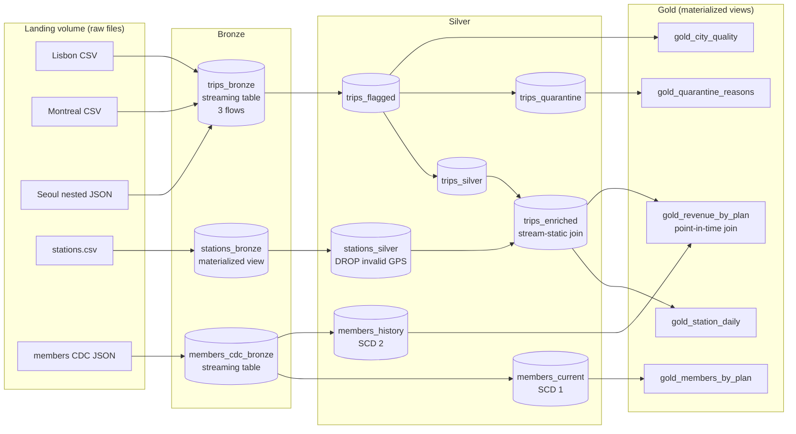
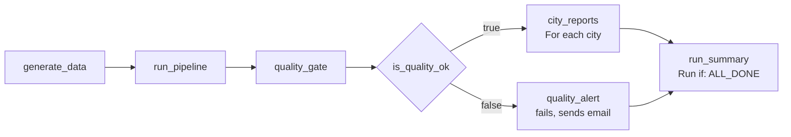

# Pedalhouse: a bike-share lakehouse on Databricks

An end-to-end, hands-on Databricks project built around a fictional bike-share
company. It covers the four Data Engineer Associate courses in practice:
**ingestion, Declarative Pipelines, Lakeflow Jobs and DevOps**, plus Delta Lake
and Unity Catalog. Every lab runs on **Databricks Free Edition**.

> Pedalhouse runs bikes in **Lisbon**, **Montreal** and **Seoul**. Each city sends
> its trips in its own format, the membership system sends a stream of changes,
> and the data is messy on purpose. The goal: clean, trustworthy numbers every
> morning, deployed like real software.

## Architecture



Orchestrated by a Lakeflow Job:



## What you practise

| Lab | Topics | Course |
|---|---|---|
| [00](labs/00_setup_and_the_lakehouse.py) | Volumes vs tables, what a lakehouse is | foundations |
| [01](labs/01_delta_lake_deep_dive.py) | ACID writes, MERGE, history, time travel, RESTORE, schema enforcement and evolution, CHECK constraints, liquid clustering, OPTIMIZE, Change Data Feed, tags, grants, column masks, row filters | Delta Lake, Unity Catalog |
| [02](labs/02_ingestion.py) | `read_files`, CTAS, COPY INTO (idempotency), Auto Loader, schema hints, schema drift, `_rescued_data`, `_metadata`, UI upload | Data Ingestion with Lakeflow Connect |
| [03](labs/03_declarative_pipelines.py) | Streaming tables vs materialized views, multi-flow, expectations (warn, drop, fail), quarantine pattern, stream-static join, event log, failure recovery, full refresh, `pipelines.reset.allowed` | Build Data Pipelines with Spark Declarative Pipelines |
| [04](labs/04_cdc_and_scd.py) | AUTO CDC, `SEQUENCE BY`, out-of-order events, SCD Type 1 and 2, `TRACK HISTORY`, point-in-time joins | Build Data Pipelines with Spark Declarative Pipelines |
| [05](labs/05_lakeflow_jobs.py) | Notebook and pipeline tasks, job parameters, task values, If/else, For each, Run if, repair runs, schedules, file arrival triggers, notifications, Jobs API | Deploy Workloads with Lakeflow Jobs |
| [06](labs/06_devops_bundles_and_ci.py) | Git folders, Declarative Automation Bundles, dev/prod targets, unit tests, GitHub Actions CI/CD | DevOps Essentials for Data Engineering |
| [99](labs/99_check_my_work.py) | **Automatic grader**: exact checks for every lab | |

## Quick start (Databricks Free Edition)

1. Sign up at [databricks.com/learn/free-edition](https://www.databricks.com/learn/free-edition).
2. Fork this repository, then in Databricks: **Workspace > Create > Git folder** and paste your fork's URL.
3. Open `labs/00_setup_and_the_lakehouse` and run it. Defaults: catalog `workspace`, schema `pedalhouse_dev` (change them with the widgets at the top).
4. Follow the labs in order. Run `labs/99_check_my_work` at any time.

## Deploy as code

```bash
databricks auth login --host https://<your-workspace>.cloud.databricks.com
databricks bundle validate
databricks bundle deploy -t dev
databricks bundle run pedalhouse_daily -t dev
```

Or open `databricks.yml` in the workspace and use the **Deployments** panel.

| Target | Schema | Mode |
|---|---|---|
| `dev` (default) | `pedalhouse_dev` | development: `[dev you]` prefix, schedules paused |
| `prod` | `pedalhouse` | production |

Use another catalog with `--var catalog=<name>`.

## Repository layout

```
├── databricks.yml                 bundle: variables and targets
├── resources/
│   ├── pedalhouse.pipeline.yml    the Declarative Pipeline
│   ├── pedalhouse_daily.job.yml   the daily job (If/else, For each, Run if)
│   └── pedalhouse_on_arrival.job.yml   file arrival trigger
├── src/
│   ├── pedalhouse/                Python package: config, data generator, transforms
│   ├── pipeline/                  pipeline source: bronze/ silver/ gold/ (SQL + Python)
│   └── jobs/                      job task notebooks
├── labs/                          the hands-on notebooks
├── tests/                         pytest: unit, integration, notebooks, bundle
└── .github/workflows/ci.yml       tests + bundle validate + manual prod deploy
```

## Testing

```bash
pip install -r requirements-dev.txt   # needs Java 17+
pytest -v
# Delta Lake downloads its jars from Maven Central on first run.
# Offline? PEDALHOUSE_NO_DELTA=1 pytest -v  (skips only the Delta test)
```

| Test file | What it proves |
|---|---|
| `test_transforms.py` | each business rule on tiny DataFrames, with `assertDataFrameEqual` |
| `test_datagen.py` | the generator: determinism, schema drift, out-of-order CDC, poison files |
| `test_pipeline_logic.py` | bronze to gold on local Spark: quarantine matches exactly the broken trips; every gold SQL file from the pipeline runs; the point-in-time join picks the right plan |
| `test_notebooks.py` | every notebook cell parses; **Lab 01 runs end to end on local Delta Lake** |
| `test_labs_against_local_lakehouse.py` | builds every pipeline table locally (AUTO CDC simulated), then **executes Lab 04 and the grader**: the grader passes a correct lakehouse and catches a wrong one |
| `test_bundle.py` | the YAML matches the official `databricks-bundles` models, file paths and references exist |

The tests cannot run the real pipeline (streaming tables, `read_files` and AUTO
CDC need Databricks). They test the same logic, and the grader notebook
checks the real pipeline's output inside your workspace.

## Free Edition notes

* Serverless only, which is what this project uses.
* One running pipeline at a time, up to 5 concurrent job tasks (the For each uses 3).
* Managed Lakeflow Connect connectors usually need credentials you won't have: Lab 02 uses the file upload connector instead.
* If a feature is unavailable in your workspace (for example a file arrival trigger on a volume), the lab tells you what you would have seen.

